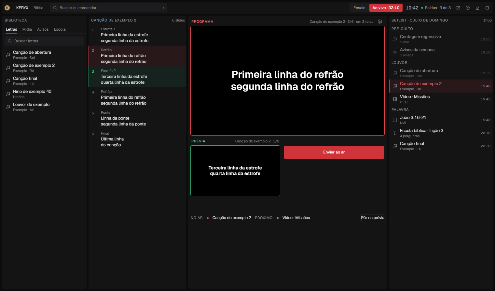
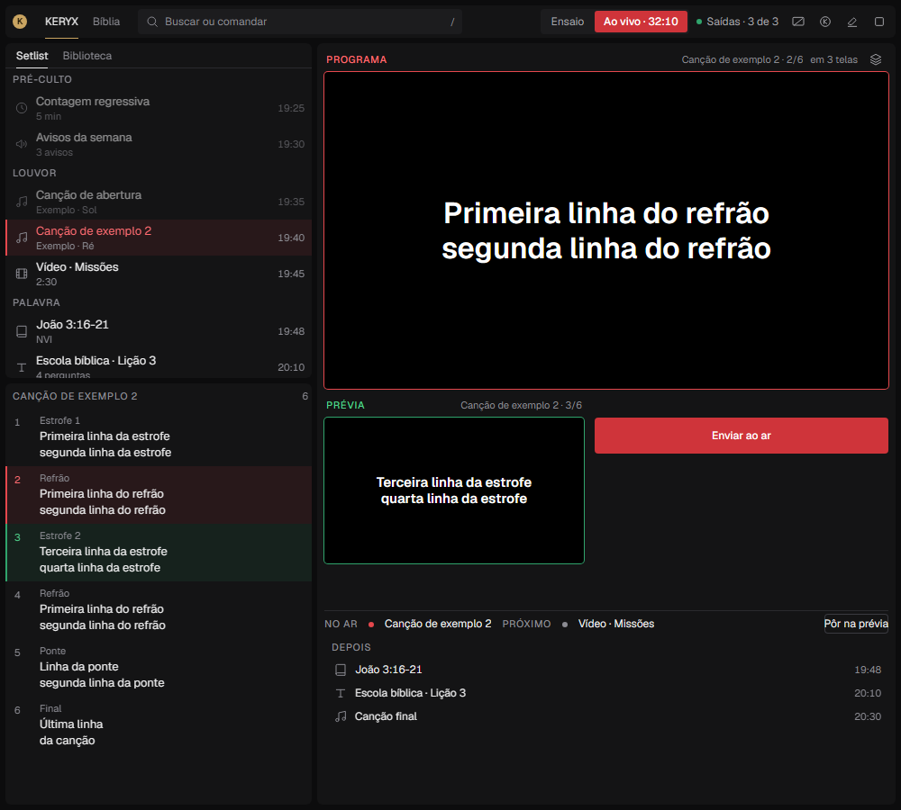
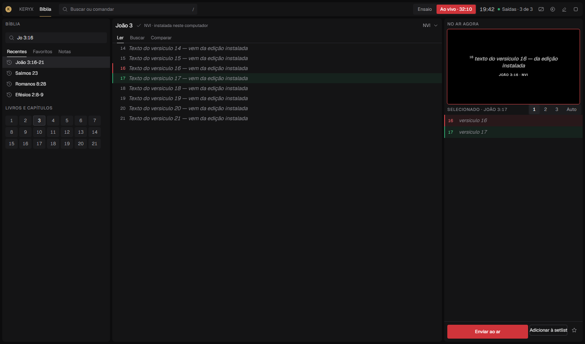
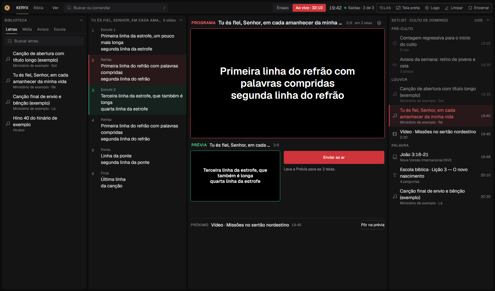
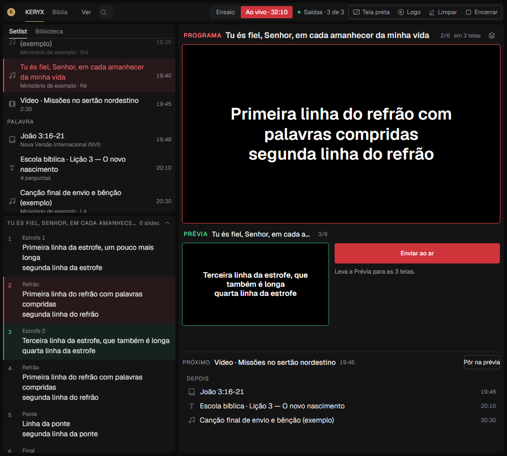
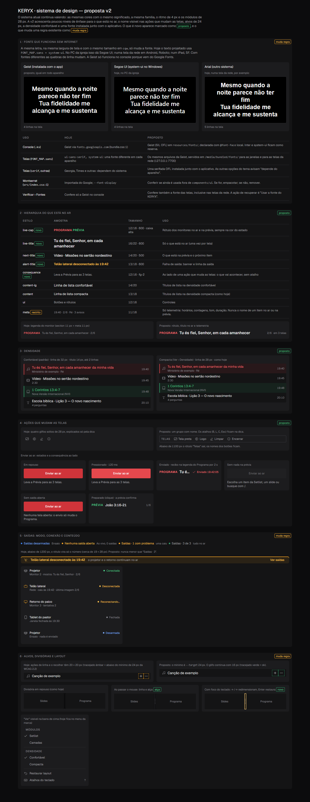

# Presenter layout proposal — desktop and side panel

Date: 2026-10-09
Answers: [`presenter-ux-research-2026-10-09.md`](presenter-ux-research-2026-10-09.md) (its five review criteria).
Mockup: [`presenter-layout-proposal/mockup.html`](presenter-layout-proposal/mockup.html). It uses only the design system (`design-system/tokens.css`, the `kx-` classes and the icon set). Serve `docs/` over http to open it, for example with the `docs-static` entry in `.claude/launch.json`. `?s=` selects a scenario.

This is a proposal. No app code has changed. Song lines and verses in the mockup are placeholders. The mockup never shows real Bible text.

## Thesis

One **live column** stays the same at every window size: Programa, then Prévia beside Enviar ao ar, then the player slot, then No ar · Próximo. Everything else is a *source* that feeds it: Biblioteca, Setlist and Slides. As the window narrows, the sources are merged into tabs. The live column is never moved below them.

The calm comes from the live column always being in the same place, not from adding panels.

## Today (worked out from the code, not measured in the app)

| Where | What the code does | Consequence |
| --- | --- | --- |
| `src/pages/Console.jsx:114` | `compact = innerWidth < 1440`. The docs say 1366. | Electron opens at 1440×900 (`electron/main.cjs:171`). The page inside the frame is a little narrower than 1440, so the console probably **opens in the compact layout by default**. |
| `console.css:204` (`max-width: 1100px`) | `.main` becomes a column. `sideCol` sets `flex: 0 1 300px` and `320px`, which become heights. | At ~1000×900, Library (~300) and Slides (~320) sit above Programa. The centre keeps about 190px, so **Prévia and Enviar ao ar are crushed or clipped** (`.mons` is `overflow:hidden`). This is worse than "below the fold". |
| `console.css:55-71` | `.prog { flex:1 }` holds a 16:9 box that is width-limited and pinned to the top. | At 1521×893 there are about **260px of empty space between Programa and Prévia** (research finding 1). |
| `PlayerBar.jsx:89` | Always mounted, "so the monitors never move". | An idle transport stays on screen. |
| `Console.jsx:369-388` | Camadas sits above the Setlist in the right column (300px). | During a service, typography and layer controls take space that belongs to the service order. |
| `useConsoleData.js:69-95` | Outputs are polled every 5s. Network screens are hard-coded `online:true` and simply vanish when they drop. | **No disconnect is ever shown.** The `Desconectada` branch in `Popovers.jsx:101` cannot occur. A closed `/Projection` window raises no banner. "Saídas · 0 conectadas" has no warning style. |
| `CenterPanel.jsx:111-114` vs `BibleEnv.jsx:374`, `SchoolView.jsx:207`, `MediaView.jsx:210` | The main send button prints **Ctrl+Enter**. Bíblia, Escola and Mídia print **Enter**. | Research finding 6. The README also says shortcuts belong in tooltips and are "never printed on buttons". |
| `BibleEnv.jsx:142` | `r.source` (local/online) is dropped. | Text fetched online is never labelled as online (research finding 5). |

The research's "AGORA —" footer does not exist in the current code. The closest is the Ensaio PiP caption "NO AR AGORA".

## The proposal

### Live column

```
┌─ PROGRAMA ── Canção 2 · 2/6 ──── em 3 telas ── [Camadas] ┐
│                                                          │
│          16:9, as wide as the column allows              │
│                                                          │
└──────────────────────────────────────────────────────────┘
┌─ PRÉVIA ── 3/6 ───────┐   ┌──────── Enviar ao ar ───────┐  ← docked right under Programa
│      16:9 · 46 %      │   └─────────────────────────────┘
│                       │   Ao enviar: … / Notas do professor
└───────────────────────┘
[ player slot · 36px · only shows a transport while media is selected or playing ]
NO AR ● Canção 2     PRÓXIMO ● Vídeo · Missões      [Pôr na prévia]
(medium/narrow: "Depois" — the rest of the Setlist fills what is left)
```

- **Size rule.** The block has one width:

  `width = min(100cqw, (100cqh − K) / 0.82125)`

  - `0.82125` is 9/16 for Programa plus 0.46 × 9/16 for Prévia.
  - `K` = 136px of fixed rows: two 24px captions, three 8px gaps, the 36px player slot and the 28px Próximo row.

  It is one container-query `calc` with no JS. Programa is width-limited on tall windows and height-limited on short ones. Either way, the empty space falls **below** the block, never between Programa and Prévia.
- **The player slot is reserved.** Its 36px is always part of `K`, so starting a video never resizes the monitors. This keeps the existing "monitors never move" decision while the idle transport disappears. Measured at 960×600: Programa is 480×270 with and without the player.
- **No ar · Próximo** is always one 28px line. It extends today's `.nextline`. It uses the README's word *Próximo* and the action *Pôr na prévia* (the app currently says "Preparar"). In the medium and narrow tiers, where the Setlist has no column of its own, the leftover height lists the next items under "Depois".
- **Camadas** moves out of the permanent column. It opens from the glyph in the Programa caption, or from *Ver*, as the existing drawer. Layers and theme edits act on what is on air, so they belong next to the Programa monitor rather than taking Setlist space for the whole service.
- **The Programa caption says where the image is:** "em 3 telas", "em 2 de 3 telas" (amber) or "em nenhuma tela" (amber). This is the third state the research asks for: content per destination, not only mode and connections.

### Width tiers (measured on `.main` with a ResizeObserver; replaces `innerWidth < 1440` and the `@media 1100` stacking)

| Tier | `.main` width | Columns, left to right |
| --- | --- | --- |
| Wide | ≥ 1400 | Biblioteca 260 · Slides 300 · **Live** · Setlist 320 (full height) |
| Medium | 1100–1399 | Setlist \| Biblioteca (tabs) 300 · Slides 280 · **Live** |
| Narrow | < 1100, down to the 960×600 Electron minimum | Setlist \| Biblioteca (tabs) over Slides, 340 · **Live** (min 520) |

There is never a single-column layout. The default Electron window (1440) becomes wide instead of compact.

```
Wide 1521×893                                         Narrow 1000×900 (side panel)
┌──────────────────── top bar ────────────────────┐   ┌────────── top bar ──────────┐
├────────┬────────┬───────────────┬───────────────┤   ├──────────┬──────────────────┤
│Biblio- │ Slides │ PROGRAMA      │ Setlist       │   │Setlist|  │ PROGRAMA         │
│teca    │        │               │ (sections,    │   │Biblioteca│                  │
│        │        ├────────┬──────┤  times)       │   ├──────────┤                  │
│        │        │ PRÉVIA │Enviar│               │   │ Slides   ├────────┬─────────┤
│        │        ├────────┴──────┤               │   │          │ PRÉVIA │ Enviar  │
│        │        │ No ar·Próximo │               │   │          ├────────┴─────────┤
│        │        │               │               │   │          │ No ar · Próximo  │
└────────┴────────┴───────────────┴───────────────┘   │          │ Depois …         │
                                                      └──────────┴──────────────────┘
```

**Measured in the mockup** (Chromium at these viewports; the app has not been measured):

| Viewport | Tier | Programa | Prévia | Send | No ar · Próximo | Scroll |
| --- | --- | --- | --- | --- | --- | --- |
| 1521×893 | wide | 595×335 | 274×154 | 309×40 | visible | none |
| 1280×800 | medium | 660×371 | 304×171 | 344×40 | visible | none |
| 1000×900 | narrow | 626×352 | 288×162 | 326×40 | visible | none |
| 960×600 | narrow | 480×270 | 221×124 | 247×40 | visible | none |




The Medium and Electron-minimum sizes are in [medium-song](presenter-layout-proposal/medium-song.png) and [min-song](presenter-layout-proposal/min-song.png).

### Bíblia

- **Wide:** keep the three columns: picker (Recentes / Favoritos / Notas first, book and chapter grid second) · Ler / Buscar / Comparar · No ar agora.
  - The air monitor is capped at 35% of the column height.
  - The action row (**Enviar ao ar · Adicionar à setlist · ★**) is pinned to the bottom of the column.
- **Narrow:** two columns.
  - The picker folds into the reading column: a reference field in the header, plus *Recentes* and *Livros* tabs.
  - The air column keeps the monitor, Selecionado and the pinned actions.
  - At 960×600 the selected verse and Enviar ao ar are both visible: the action is at y = 550 of 600.
- The passage header shows an **edition badge** from the `source` that is dropped today:
  - "NVI · instalada neste computador"
  - "ARA · online" (amber: it needs the internet)
  - "ARA · não instalada" (amber)



The narrow and minimum-size layouts are in [narrow](presenter-layout-proposal/narrow-bible.png) and [960×600](presenter-layout-proposal/min-bible.png).

### Output state (three separate questions)

1. **Are we live?** The Ensaio | Ao vivo segment. It already exists and is unchanged.
2. **Are the destinations there?** The Saídas chip.

   | Situation | Chip | Style |
   | --- | --- | --- |
   | Ensaio | "Saídas desarmadas" | blue |
   | Ao vivo, 0 outputs | "Nenhuma saída aberta" | **amber** |
   | A destination dropped | "Saídas · 1 com problema" | amber |
   | Everything connected | "Saídas · 3 de 3" | green dot |

   A green dot never appears next to a zero.
3. **What is each one showing?** Each row in the Saídas popover shows the name, the state (Desarmada / Conectada / Reconectando / **Desconectada** / Fechada), "Mostra: …" and a recovery action: *Abrir projetor*, *Reabrir*, *Copiar link da tela* or *Identificar*.

**Disconnect detection** (to build): remember every destination seen during the session.

- When a network screen leaves or `/Projection` closes, the row becomes Desconectada or Fechada with the time.
- A full-width amber `kx-banner` names it: "Telão lateral desconectado às 19:42 · o projetor e o retorno continuam no ar · Ver saídas". Banners never cover a monitor, and recovery wins over the Ensaio banner.
- The logic belongs in a pure, tested helper, `src/lib/console/outputs.js`, that derives `{chip, rows, banner}` from `useOutputs` and the session memory.
- Verificar stays an overlay from Saídas.

## Review criteria

### 1. Desktop and ~1000×900, with Program, Preview, Send, current/next and outputs visible

Met in all four measured sizes (table above). The Saídas chip and the four emergency glyphs are in the top bar at every width.

### 2. Scenarios: what stays and what changes

What stays in every scenario: the top bar, Programa, Prévia, Enviar ao ar, and No ar · Próximo. What changes is listed per scenario.

- **Song advance** ([wide](presenter-layout-proposal/wide-song.png), [narrow](presenter-layout-proposal/narrow-song.png)).
  - Flow: click a Setlist row → its first slide goes to the Prévia → Enter → → / ← walk the song on air.
  - What changes: the Slides list (red = on air, outline = next, green = prepared) and the monitor captions ("2/6").
- **Unexpected Scripture** ([wide](presenter-layout-proposal/wide-scripture.png), [narrow](presenter-layout-proposal/narrow-scripture.png)).
  - Flow: `/` → "jo 3 16".
  - Today the palette opens the Bíblia environment and puts the verses in the Prévia (`Popovers.jsx:193`). That path stays as "Abrir na Bíblia".
  - **Proposed:** Enter puts the verse in the Prévia *here*, without leaving the console, and Shift+Enter adds it to the Setlist.
  - The palette opens **left-anchored over the source columns and never covers the Programa**. Today it is centred, 620px wide, at `top: 96px`.
- **Video** ([wide](presenter-layout-proposal/wide-video.png), [960×600](presenter-layout-proposal/min-video.png)).
  - What changes: the transport fills the reserved slot under the Prévia (pause, stop, time, seek in red while live, meters, "Toca em").
  - Programa plays muted, as today. The send note says "toca nas telas de vídeo; o projetor continua como está".
  - Nothing else moves.
- **Escola bíblica question/answer** ([wide](presenter-layout-proposal/wide-school.png), [narrow](presenter-layout-proposal/narrow-school.png)).
  - The question is on air and the answer waits in the Prévia ("→ revela").
  - The teacher notes sit beside the Prévia, under Enviar ao ar, labelled "só no console e no palco". This is the existing `content.stage` and `stageFromMaterial` behaviour, laid out in the live column.

### 3. Every action that changes an audience output

| Action | Op | Mouse | Keyboard | Guard today |
| --- | --- | --- | --- | --- |
| Enviar ao ar | `session.item` (+ `video.show`) | Enviar ao ar; double click on a Biblioteca, Setlist, slide, verse, search-result, material or Mídia row; Setlist "Ir"; drag onto Programa; Comparar › Enviar | Enter (nothing focused or monitors focused) · Ctrl+Enter (anywhere except a text field) | Ignored in text fields (`keys.js:44`); refused when the media file is missing |
| Next / previous slide | `content.next` / `content.prev` | Anterior / Próximo; Escola chevrons | → / ← | Not in text fields, radiogroups, tablists or menus |
| Tela preta / Mostrar logo | `screen.set` | Top bar glyphs; projector banner | B / L | **Reach the screens even in Ensaio** |
| Limpar texto | `tool.clear`, `communication.clear`, `content.clear` | Top bar glyph | C | Not in text fields |
| Encerrar | `clear` | Top bar stop → **asks** (`EndDialog`) | **Esc → no question** | Esc in a text field only blurs it |
| Media transport | player ops | Play/pause, ±10, stop "Parar e tirar do ar", seek, volume | Space | Not on a control |
| Aviso rápido (alert) | `alert.show` / `alert.clear` | "Tirar" | **Enter in the aviso field projects immediately** | By design: the one control that bypasses the Prévia (`kx-alert`) |
| Camadas edits | `logo.set`, `overlays.set`, `content.update`, `background.*`, `layers.order` | Every control in Camadas | — | **Applied immediately in Ao vivo** |
| Idle screen | `idle.set` | Its menu | — | — |

These do **not** change an output: ↑ / ↓ (selection), palette Enter (Prévia only) and Voltar ao anterior (Prévia only).

**Focus model.** Typing is safe. Every live key returns null inside `input`, `textarea`, `select` and contenteditable, and AltGr counts as typing (`keys.js:29,44`). The exceptions are deliberate (the aviso field) or listed below.

**Decisions for you.** Each of these is a product decision, so I have not changed any of them.

1. **Esc ends the projection at once.** This is recorded in `design-system.md` as a deliberate departure from the canvas. The risk the research points at: Esc in a text field blurs it, and a second Esc ends the service. One option keeps Esc instant but makes the toast's "Voltar ao anterior" restore the Programa, not only the Prévia. Another is to ask only when Esc follows a blur within ~1s.
2. **B and L act on the real screens in Ensaio.** That suits an emergency. Confirm it is intended.
3. **Camadas edits go live immediately.** Moving Camadas into the contextual drawer next to Programa (above) makes it a deliberate act. A "changes apply on Enviar" mode is possible but adds a mode.
4. **Shortcut labels (copy only).** Remove the printed "Ctrl+Enter" (the README says shortcuts belong in tooltips) and use one tooltip everywhere: "Enviar ao ar · Enter (Ctrl+Enter de qualquer lugar)". Behaviour does not change.

### 4. Failure states

- **No output connected** ([wide](presenter-layout-proposal/wide-nooutput.png), [narrow](presenter-layout-proposal/narrow-nooutput.png)).
  - The chip is amber: "Nenhuma saída aberta".
  - The Programa caption reads "em nenhuma tela".
  - The popover's empty state offers *Abrir projetor* and *Telas na rede…*.
- **One destination drops mid-service** ([wide](presenter-layout-proposal/wide-disconnect.png), [narrow](presenter-layout-proposal/narrow-disconnect.png)).
  - The amber banner names the destination and says the others continue.
  - The chip reads "1 com problema" and the caption "em 2 de 3 telas".
  - The popover row reads "Desconectada · caiu às 19:42", shows the last image, and offers *Copiar link da tela*.
  - The popover is transient (Esc or a click closes it). The banner and the chip carry the state while it is closed.
- **Bible edition unavailable** ([wide](presenter-layout-proposal/wide-biblemissing.png), [narrow](presenter-layout-proposal/narrow-biblemissing.png)).
  - The header badge reads "ARA · não instalada".
  - The reading pane is an empty state: "A ARA não está instalada neste computador. Sem internet, nenhum texto será mostrado. O KERYX nunca projeta texto de exemplo no lugar." It offers *Instalar ARA* and *Trocar para NVI*.
  - Enviar ao ar and Adicionar à setlist are disabled, and the No ar agora monitor keeps what is really on air.
  - This uses the messages `bibleText.js` already throws (`:68-81`).

### 5. Tokens and components

The mockup uses only existing tokens and classes: `kx-panel`, `kx-mon` (is-air / is-prev), `kx-row`, `kx-slide`, `kx-verse`, `kx-tabs`, `kx-seg`, `kx-status` (is-warn), `kx-out`, `kx-banner` (is-warn), `kx-pop`, `kx-transport`, `kx-meter`, `kx-empty` and `kx-btn-air` / `-outline`. It adds no colour, size or type style. The only new CSS is layout: the tier widths, the live-block `calc`, the docked live row and the left-anchored palette.

The P0 goal needs these rule changes in `docs/design-system.md` and the README:

```diff
- At 1366px wide the right-hand modules become a drawer and the rundown moves into the library tabs.
+ Width tiers on the console grid (not the window): wide ≥ 1400 four columns; medium 1100–1399
+ Setlist|Biblioteca tabs, Slides, live; narrow < 1100 sources stacked in one column beside the
+ live column. The live column is never stacked below anything and the page never scrolls.

- Programa (58 %) and Prévia (42 %) side by side …
+ The live column: Programa as wide as it can be, the Prévia (46 %) and Enviar ao ar docked directly
+ under it, a reserved 36 px player slot, then one No ar · Próximo line. Spare height goes below.
+ (Side by side needs ≥ ~900 px of live width to keep both monitors legible; no tier has it.)

- Player: one 36 px row on top of the Programa … always there.
+ Player: shown only while media is selected, on air or playing, in a slot under the Prévia that is
+ always reserved, so the monitors never move.

+ Camadas is contextual: a drawer opened from the Programa caption or Ver, not a permanent module.
+ The command palette opens left-anchored over the source columns and never covers the Programa.
```

## Implementation order (later, on approval)

1. **P0 layout.**
   - Add a `useConsoleTier` hook (ResizeObserver on `.main`) that replaces `compact` and the 1100 media query.
   - Restructure the live column in `CenterPanel.jsx` (`.prog` sized by the `calc`, no `flex:1`) with the reserved player slot.
   - Add the No ar · Próximo line and move Camadas into a drawer.
   - Verify: `npm run dev` at 1000×900 and 960×600, then the smoke at the end.
2. **P0 outputs.**
   - Add `src/lib/console/outputs.js` (pure, with a test) that derives the chip, rows and banner, plus the session memory of destinations.
   - Wire it into `TopBar`, `Popovers` and the banner. Add "em N telas" to the Programa caption.
   - Verify with two windows: console and output, local and network.
3. **P1 Bíblia.** Pin the action row, cap the monitor, add the narrow two-column tier, and add the edition badge from `source`.
4. **P1 palette.** Anchor it left, and let Enter on a reference put it in the Prévia here (Shift+Enter adds it to the Setlist). *Built 2026-10-10: it stops short of the Programa monitor and also reads the quick jump's "jo 3 16".*
5. **Copy.** Unify the send tooltips. Then the decisions above, once you answer them.

## Limits

- The "today" claims are derived from the code and CSS. I have not rendered the current app at 1000×900. The P0 work should begin by confirming the clipping in `npm run dev`.
- The measurements come from the mockup, not the app. The real live column also holds the Ensaio PiP and the Programa's motion video. Neither changes the sizing rule.
- Competitor behaviour comes from the research brief only. I did not verify it.

---

# Part 2 — the UX addendum: type, hierarchy, discoverability, one design system

Answers: [`presenter-ux-addendum-2026-10-09.md`](presenter-ux-addendum-2026-10-09.md), read together with the main brief.
Visuals:
- [`mockup-v2.html`](presenter-layout-proposal/mockup-v2.html): the Part 1 layout with the additions below. `?s=song|sent|scripture|video|school|nooutput|disconnect|ver` selects a scenario, and `&d=compact` selects the compact density.
- [`design-system-v2.html`](presenter-layout-proposal/design-system-v2.html): a specimen sheet that marks each addition as *proposto* or *muda regra*.

The layout, the tiers and the output states of Part 1 are unchanged. Part 2 changes how things read and how they are found.





## What stays exactly as decided

The addendum says its findings are "not authorization to replace established workflows". Nothing below changes these decisions:

- One console, always live. Ensaio is the sandbox, and Verificar is an overlay from Saídas.
- **Setlist** is the name.
- A click prepares. Enter, a **double click**, a drag onto Programa or *Enviar ao ar* sends (2026-10-07).
- Arrows and keys follow Holyrics: ←/→ move what is on air, ↑/↓ move the selection.
- Esc ends at once, and the Encerrar button asks.
- The palette, the colour meanings, the type family, the 4px rhythm and the 28px module headers stay.
- Bible text only from installed or online editions, never bundled.

## A1 · Type that renders the same offline

The addendum found Geist and Montserrat loaded from Google Fonts, and no font files in the repository. The code shows a second, larger issue: **projected text never uses Geist**.

- `ScreenRenderer` sets every text layer's family from `FONT_MAP` (`src/lib/deviceStyles.js`), and `FONT_MAP.sans` is `ui-sans-serif, system-ui, sans-serif`. Geist is only the `.ks` base (`screen.css:5`).
- On the church PC, the console monitors and the projector windows run on the same Windows, so they agree (Segoe UI).
- A **network screen** renders on its own device: Roboto on Android, SF on an iPad. Its line breaks differ from the Programa monitor the operator is watching.
- The specimen measures it, rendering the same lyric at the same `cqw` size on a 400px screen:

  | Font | Lines on screen |
  | --- | --- |
  | Geist | 4 |
  | Segoe UI | 4 |
  | Arial | 5 |

  It is rendered live in [`design-system-v2.html`](presenter-layout-proposal/design-system-v2.html), section 1.

**Proposal:**

1. Ship Geist (SIL OFL 1.1) as `.woff2` in `resources/fonts/`, alongside the other files that ship with the app. Serve it as `/media/bundled/fonts/…`, which the network screens already reach on port 7700.
2. Declare one `@font-face` for the console and the screens, and remove the Google import from `bundle.css`.
3. Map `FONT_MAP.sans` to the bundled family, with `system-ui` behind it as the recovery path.
4. Ship one OFL serif for `FONT_MAP.serif`. The other theme options (Arial, Georgia, Times, Verdana, cursive) say "depende do aparelho" in the theme editor.
5. Check whether Montserrat (`src/index.css:1`, `--font-display`) is still used outside `components/ui`. If it is, bundle it; if not, remove it.
6. In Verificar › Fontes, check the *screen* family as well as the console's, including from a connected network screen (it can report `document.fonts.check` over `/api/events`). The recovery action is "Usar a fonte do KERYX".

**Acceptance (the addendum's, unchanged):**
- With the internet off and an empty font cache, compare one long lyric and one long passage on Programa, Prévia, an Electron output and a network screen. The font and the line breaks should agree.
- Verificar reports a missing required font, with an action that fixes it.

## A2 · A hierarchy for what is on air

The new type styles keep to the family, the palette and the 4px rhythm.

| Style | Size | Only for |
| --- | --- | --- |
| `live-cap` | 12/16 · 600 · caps · state colour | The PROGRAMA and PRÉVIA labels |
| `live-title` | 16/22 · 600 | The item on air (once per screen, in the Programa caption) |
| `next-title` | 14/20 · 500 | The item in the Prévia and the Próximo item |
| `alert-title` | 13/18 · 600 | The output-failure banner |
| `consequence` | 12/16 · fg-2 | The line beside an action that changes the screens |
| `meta` (restricted) | 11/16 | Telemetry only: times, counts, key, length. **Never the name of a live or prepared item.** |

Other changes:

- **The Próximo line** gives the next item the full width and its time. The item on air is already the Programa caption's title, so the line no longer repeats it, and long titles keep about twice the room.
- **Density.**
  - *Confortável* is the proposed default: 32px rows, 14px titles that wrap to two lines.
  - *Compacta* is today's 28px rows on one line.
  - Both live in *Ver › Densidade* and are saved per operator, like the layout. Compare [comfortable](presenter-layout-proposal/v2-narrow-song.png) and [compact](presenter-layout-proposal/v2-narrow-song-compact.png).
- **Long pt-BR names.** The mockup uses names like "Tu és fiel, Senhor, em cada amanhecer da minha vida", "Avisos da semana: retiro de jovens e ceia" and "Escola bíblica · Lição 3 — O novo nascimento". The Setlist also keeps the on-air row scrolled into view.

**Measured in mockup v2** (Chromium; not the app):

| Viewport | Programa | Item title on air | Prévia | Send | Próximo | Scroll |
| --- | --- | --- | --- | --- | --- | --- |
| 1521×893 | 595×335 | 362px, 16px type | 274×154 | 309×40 | 595×40 | none |
| 1000×900 | 626×352 | 393px | 288×162 | 326×40 | 626×40 | none |
| 960×600 | 446×251 | 213px | 205×115 | 229×40 | 446×40 | none |

The bigger captions cost Programa 34px of width at 960×600, compared with Part 1's 480. At the other sizes Programa is width-limited, so nothing changes.

## A3 · Controls you can find without hovering

- **The actions that change the screens have names.** The four emergency glyphs become one framed group in the top bar, captioned **TELAS**: *Tela preta · Logo · Limpar · Encerrar*.
  - Below 1100px the caption drops, but the names stay. The group measured 303×28 at 960 wide.
  - Shortcuts (B, L, C, Esc) stay in tooltips and in the Atalhos list, as the README requires.
- **The consequence sits beside Enviar ao ar.** It reads "Leva a Prévia para as 3 telas.", or in amber "Nenhuma tela aberta: o envio só muda o Programa." when there is no output.
- **A press gets an answer.**
  - Enviar ao ar darkens for 120ms, and the Programa caption shows "✓ Enviado 19:42:05" for 2s ([v2-wide-sent](presenter-layout-proposal/v2-wide-sent.png)).
  - A click that prepares is answered by the Prévia caption's title. Nothing new is needed there.
- **Ver is in the top bar.** Today it is one level inside the KERYX mark menu (`Popovers.jsx:58`). It lists the modules, Densidade, *Restaurar layout* and *Atalhos do teclado* ([v2-wide-ver](presenter-layout-proposal/v2-wide-ver.png)). The menu opens over the source columns, not over the Programa.
- **Splitters show a grip** on hover and on keyboard focus.
  - Proposed: splitters become focusable `role="separator"` elements; ←/→ resize, Enter restores. Double-click restores, as today.
  - The grip is drawn in [v2-wide-ver](presenter-layout-proposal/v2-wide-ver.png) between Slides and Programa.
- **Pointer targets.** A new `--target: 24px` sets the minimum for any control; the glyph stays 16px.
  - Today `kx-row .kx-btn` and `kx-layer .kx-btn` are 20×20 (`bundle.css:84-85, 177`).
  - At ≤1200px the Saídas label shrinks to just the number (`console.css:36-37`, the ~19×28 the addendum measured). Proposed: it is never shorter than "Saídas · 3".
  - Mockup v2 has **no button under 24×24** at any of the four sizes. That is a script check of every `button` in the console; the real app still needs the audit the addendum asks for.

## A4 · One account of the design system

Each row is a statement in the design-system docs that disagrees with the app and `CLAUDE.md`, with proposed wording. These are proposals; the design-system files are unchanged.

| Where | Says now | The app and `CLAUDE.md` | Proposed wording |
| --- | --- | --- | --- |
| README:5 | "Nothing reaches the screens by being clicked. A click prepares; only Enviar ao ar, Enter or the arrow keys change what is on air." | A click prepares; Enter, a **double click**, a drag onto Programa or Enviar ao ar sends | "A click prepares (`prev`). Enviar ao ar, Enter, a double click or a drag onto the Programa sends (`air`); ←/→ move what is on air. A single click never reaches the screens." |
| README:14 (vocabulary) | **Roteiro** | **Setlist** | Replace Roteiro with Setlist. Add *Fechada*, *Desarmada* and *Telas* (the action group). |
| README:16 (captions) | `Próximo: Firme na rocha · Preparar`, `Saídas · 5 conectadas` | The app's `.nextline` says "Preparar"; the vocabulary says "Pôr na prévia" | `Próximo · Firme na rocha · 19:45 · Pôr na prévia`, `Saídas · 3 de 3`. Use *Pôr na prévia* everywhere, as the palette already does. |
| README:42 (layout) | "At 1366px wide the right-hand modules become a drawer" | Code switches at 1440; Part 1 proposes tiers | The Part 1 tier rule |
| README:56 (icons) | Bare glyphs, explained by tooltip | — | Keep for secondary controls. "Actions that change the screens carry a visible name, grouped under *Telas*." |
| design-system.md:27-63 | Preparar / Verificar / Apresentar described as views | The steps were cut the same day | Move under a **Histórico** heading, with the date and the reason |
| design-system.md:42-46 | Send button with "Ctrl+Enter" printed under it | Shortcuts belong in tooltips (README:56) | Tooltip "Enviar ao ar · Enter (Ctrl+Enter de qualquer lugar)" on every send button |
| design-system.md:83-87 | Double click and Esc listed as "departures" in a footnote | They are the decided behaviour | Promote them to a **Comportamento** section that states the rule |
| Claude Design canvas (artboards 8–15) | Three-step views, "Roteiro" | — | Label them "Histórico · 2026-10-07" in the canvas. This is an edit to your external artifact, so I have not touched it. |

**Acceptance:** read the README, `design-system.md`, `CLAUDE.md` and the running console side by side. Setlist, the modes, click / double click / Enter, the shortcuts and the output labels give one account. A short usability test (the addendum's suggestion) then checks whether the live boundary is obvious enough.

## Implementation order, updated

Part 1's order stays, with these slotted in:

1. **Fonts first.** It is independent and lowers risk.
   - Bundle the files, add `@font-face`, map `FONT_MAP`, remove the Google imports, and extend Verificar.
   - Verify offline across Programa, an Electron output and a network screen, then run the smoke at the end.
2. **The P0 layout together with A2 and A3.**
   - Add the new type styles and `--target` to `tokens.json`, `tokens.css` and `bundle.css`, then use them in the live column. The same edit adds the Telas group, Ver in the top bar, the splitter grip and keys, and the density setting.
3. **The A4 documentation pass.** It needs no code. It can land before or with step 2 so the system and the app change together.

## Limits (Part 2)

- The font comparison uses fonts installed on this Windows PC. Arial stands in for "another device's system font", because Roboto and SF are not installed here. The offline test on the real network screens is still to do.
- The target and hierarchy measurements are of the mockup. The running app at 1000×900 has not been measured here: port 5180 is in use by another session.
- The mockup still loads Geist from Google Fonts, as the current system does. It cannot demonstrate the bundled font until the files exist.
